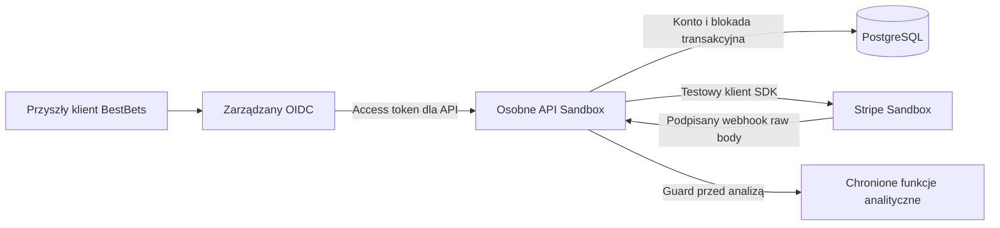

# BestBets — konta OIDC i Premium 10 USD / miesiąc (Sandbox)

Stan: 11 listopada 2026. Osobna gałąź od `main` (`76e6b46`). Wykorzystano
kod PR #44 (`b86f92a`) i opisano jego ocenę w [audycie](STRIPE_BESTBETS_SANDBOX.md).
Publiczny `app.py`, HTML/CSS, logo, wykresy, animacje i dane NBA pozostają identyczne.

**To odrębny testowy backend, nie uruchomiony paywall publicznej aplikacji.**
Obecne ścieżki Streamlit nie wywołują nowego API i zachowują dotychczasowe działanie.
Przed ich monetyzacją trzeba podłączyć zweryfikowaną tożsamość i egzekwować guard
na każdej serwerowej ścieżce analitycznej. Ukrycie przycisku lub odpowiedź
`authorized:true` w przeglądarce nie zabezpiecza innego endpointu.

## Uzgodnienia i decyzje

Użytkownik wybrał **standard OIDC, dostawca później**. Nie wdrażamy teraz
rejestracji, strony logowania ani rzeczywistych płatności.

Domyślne zasady testowe:

- Premium: stały Price 1000 centów USD, odnawianie co miesiąc, jedna sztuka.
- Free: terminarz, drużyny, zawodnicy, kontuzje. Premium: Player Props,
  kalkulator i symulacje; polityka jest w `policy.py`.
- Brak darmowego trialu, rabatów, kredytów i okresu grace dla zaległych płatności.
  Początkowy adapter obsługuje rozliczone płatności kartą. Inne metody/credits
  wymagają osobnej polityki i testów; nie są automatycznie traktowane jako zapłata.
- Anulowanie przez Portal na koniec okresu zachowuje opłacony dostęp do jego końca.
  Natychmiastowe zakończenie, zaległość, zwrot lub spór blokują dostęp.
- Sandbox nie nalicza podatków. **Przed live trzeba ustalić, czy 10 USD jest
  ceną końcową brutto czy ceną bazową oraz prawidłowe VAT/sales tax.**

### Rekomendacja IdP przed wdrożeniem

Rekomenduję rozważyć **Auth0 Universal Login** z tenantem w uzgodnionym regionie,
RS256, osobnym API Audience i zakresem `bestbets:api`. Alternatywą jest Cognito;
wybór wymaga oceny kosztów, DPA, regionu, eksportu kont i warunków dostawcy.
Nie założono tenantów ani aplikacji, nie wybrano dostawcy w imieniu użytkownika.

Dostawca ma obsługiwać rejestrację, weryfikację e-maila, bezpieczne hasła,
reset hasła, MFA i ochronę logowania. Backend nie gromadzi haseł i nie łączy kont
po samym e-mailu. Konto identyfikuje unikalna para `(issuer, subject)`.

Pełny przepływ przeglądarkowy po zatwierdzeniu dostawcy: oficjalny klient OIDC,
Authorization Code + PKCE, sprawdzane `state` i `nonce`, jawne allowlisty callbacków,
rotacja refresh tokenów i wykrywanie ponownego użycia. Preferowany BFF przechowuje
tokeny serwerowo; cookie sesji host-only, HttpOnly, Secure, SameSite i ochrona CSRF.
Nie zapisujemy refresh tokenów w localStorage. Ten etap jest **projektem**, nie
zaimplementowaną stroną logowania w publicznym BestBets.

Obecne API przyjmuje wyłącznie Bearer **access token** dla właściwego API Audience.
Sprawdza podpis RS256, statyczny JWKS URL, `iss`, `aud`, `exp`, `iat`, `sub`,
`email_verified=true` i `scope=bestbets:api`; limit czasu tokenu to godzina,
zalecany operacyjnie 5–15 minut. Nie używa tokenowego `jku`/`x5u`.
`OIDC_EMAIL_VERIFIED_CLAIM` pozwala wybrać nazwę podpisanego claimu; np. Auth0
może wymagać namespaced claimu ustawionego przez serwerową Action na podstawie
zweryfikowanego e-maila. Nie należy brać tej wartości z edytowalnego user_metadata.
IdP, Audience, mappery i rotację kluczy trzeba sprawdzić w realnym E2E.

## Architektura i granice zaufania



Nowe API nie ufa podanym przez klienta `user_id`, `customer_id`, `subscription_id`,
Price, statusowi, rolom ani parametrom success URL. Modele żądań odrzucają
nieznane pola. Lokalny UUID konta pochodzi z bazy po weryfikacji tokenu.
Klient Stripe pochodzi wyłącznie z rekordu tego konta i ma unikalne przypisanie.

### Trwałe dane

Alembic tworzy sześć tabel; PostgreSQL jest bazą docelową, SQLite wymaga jawnego
przełącznika i służy wyłącznie do lokalnych testów.

| Tabela | Cel |
|---|---|
| `billing_accounts` | Wewnętrzny UUID, issuer/sub, unikalny customer ID, blokada konta |
| `billing_checkouts` | Trwała próba z UUID, sesją Stripe, terminem i wersją zaakceptowanej informacji; jeden otwarty rekord na konto |
| `billing_subscriptions` | Ostatnie zweryfikowane subskrypcje, powiązanie z kontem, plan i opłacony termin |
| `billing_entitlements` | Decyzja Premium, termin, źródłowa subskrypcja, świeżość i anulowanie |
| `billing_events` | Unikalny event ID, hash payloadu, wynik i czas; bez pełnego payloadu |
| `billing_rate_limits` | Limity między workerami, haszowane identyfikatory, usuwanie wygasłych bucketów |

`SELECT FOR UPDATE` serializuje operacje dla konta na PostgreSQL. SQLite używa
`BEGIN IMMEDIATE` i nie jest zamiennikiem skalowalnej bazy produkcyjnej.
Serwer używa UTC/epoch, nie daty ani strefy przesłanej przez przeglądarkę.
Migracje są jawne — API nie wykonuje automatycznie `create_all` przy starcie.

### Checkout i Portal

1. Serwer uwierzytelnia konto, sprawdza limity i dokładny testowy Account/Price/Product.
2. Tworzy klienta Stripe z kluczem idempotencji związanym z trwałym UUID konta.
3. Rezerwuje i zatwierdza w bazie próbę Checkout **przed** zewnętrznym utworzeniem
   sesji. Ponowienie po awarii używa tego samego klucza, klienta i parametrów.
4. Równoległe karty dostają tę samą otwartą sesję. Istniejąca subskrypcja nie
   powoduje drugiego zakupu; używany jest Portal. Niepotwierdzoną starą próbę
   można odnaleźć po serwerowych metadanych, bez zgadywania ID z przeglądarki.
   Próba jest związana z zaakceptowanym Price i wersją informacji; zmiana configu blokuje jej ponowne użycie.
5. Hosted Checkout pobiera dane karty. Backend i BestBets nie przechowują PAN/CVC.
6. Powrót z Checkout jest wyłącznie nawigacją. Dostęp wynika z weryfikacji serwerowej.
7. Portal pobiera klienta z bazy konta. Wymagana testowa konfiguracja pozwala na
   aktualizację metody płatności i anulowanie na koniec okresu, bez samodzielnej zmiany planu.

Jawne potwierdzenia informacji o odnawianiu i aktualnej wersji warunków są
wymagane przez testowe API i zapisywane przy próbie. Są to dowody techniczne
przepływu Sandbox, **nie dowód prawnego zatwierdzenia treści ani pełnej zgody
konsumenckiej w przyszłym interfejsie**.

### Nadawanie i odbieranie dostępu

Warunki łączne: poprawny właściciel i środowisko, subskrypcja `active`, jeden
właściwy produkt/Price po 10 USD miesięcznie, opłacona faktura tego samego okresu,
rozliczony PaymentIntent i charge, brak refund/dispute, niewygasły okres.
Sprawdzane są też identyfikatory klienta, faktury, płatności i subskrypcji.
Nie dopuszczamy wpisania `premium=true` ani przyznania dostępu samym `active`.

Zweryfikowana decyzja ma lease maksymalnie 60 s i nigdy nie przekracza końca
opłaconego okresu. Jeśli po wygaśnięciu świeżości Stripe nie odpowiada, guard
zwraca 503 zamiast zezwolenia. Zweryfikowany webhook z nieudaną rekoncyliacją
unieważnia świeżość poprzedniego allow; ponowienie nie jest oznaczone sukcesem.
Przy sporze/zwrocie początkowa polityka jest konserwatywna — ewentualne
przywrócenie po wygranym sporze wymaga osobnego uzgodnienia i testów.

### Webhooki i utracone zdarzenia

- HMAC weryfikuje oficjalny SDK Stripe na dokładnych bajtach i z tolerancją 300 s;
  limit body 1 MiB, jeden nagłówek podpisu, odrzucane live/Connect.
- Event ID jest kluczem unikalnym. Ten sam ID z inną treścią jest konfliktem,
  nie kolejną operacją. To nie jest obietnica exactly-once dostarczania przez Stripe.
- Zapis sukcesu zdarzenia i aktualizacja uprawnień są jedną transakcją. Awaria
  wycofuje zapis sukcesu; Stripe otrzymuje błąd i może ponowić dostarczenie.
- Status z payloadu **nie** steruje dostępem. Pod blokadą konta pobierany jest
  bieżący stan wszystkich jego subskrypcji i płatności. Stare anulowanie nie
  nadpisze nowej, aktywnej i opłaconej subskrypcji.
- Nieznany customer nie tworzy ani nie przejmuje konta. Metadane są dodatkową
  kontrolą, nie źródłem powiązania tożsamości.
- Operator ma uruchamiać `python -m billing_backend reconcile` co minutę,
  monitorować wynik i ponowienia. Odczyt po 60 s też dokonuje rekoncyliacji.
  Nie skonfigurowano żadnego publicznego zadania ani webhook destination.

## Endpointy testowe

| Metoda i ścieżka | Działanie |
|---|---|
| `GET /healthz` | Liveness, jawne `environment=sandbox` |
| `GET /v1/me` | Zweryfikowane konto i bieżąca decyzja Premium |
| `POST /v1/billing/checkout` | Wymaga tokenu i trzech pól: `accept_terms:true`, `acknowledge_recurring:true`, `terms_version` |
| `POST /v1/billing/portal` | Token, body `{}`; własność klienta z bazy |
| `GET /v1/features/{feature}` | Publiczna polityka Free/Premium, nie dane analityczne |
| `GET /v1/premium/check/{feature}` | Przykład serwerowego egzekwowania guardu, 403 bez Premium |
| `POST /webhooks/stripe` | Wyłącznie zweryfikowane powiadomienia Sandbox |

Nowe właściwe endpointy analityczne muszą wywołać ten sam guard **przed**
uruchomieniem obliczeń, zwracaniem wyniku lub odczytem eksportu. Nie wolno
przyjmować wcześniejszej odpowiedzi `/check` jako uprawnienia od klienta.

Limity są trwałe: 120 prób autoryzacji/IP/min, Checkout 5/konto/10 min, Portal
10/konto/10 min. Nie ufamy `X-Forwarded-For`. Przed hostingiem należy jawnie
skonfigurować zaufany proxy i limity na brzegu; szczególnie dla wspólnych NAT.
CORS dopuszcza jedynie skonfigurowany origin bez ambient cookies. Odpowiedzi
API mają `no-store`; błędy nie ujawniają odpowiedzi SDK, sekretów ani payloadów.

## Uruchomienie lokalne

1. Utwórz osobne środowisko Pythona i zainstaluj:

   ```bash
   python -m pip install -r requirements-billing-sandbox.txt
   ```

2. Przez lokalne środowisko lub manager sekretów ustaw poniższe nazwy.
   Nie zapisuj wartości do repozytorium, historii poleceń ani rozmowy:

   - `BILLING_DATABASE_URL` — PostgreSQL (`postgresql+psycopg://...`), konto aplikacji z minimalnymi uprawnieniami; zdalne połączenia wymagają `sslmode=verify-full` także dla migracji.
   - `OIDC_ISSUER`, `OIDC_API_AUDIENCE`, `OIDC_JWKS_URL` — operator określa zaufane wartości HTTPS.
   - Opcjonalny `OIDC_EMAIL_VERIFIED_CLAIM` — podpisany claim mapowany przez IdP.
   - `STRIPE_TEST_SECRET_KEY` — wyłącznie testowy klucz; nie są obsługiwane klucze live.
   - `STRIPE_TEST_WEBHOOK_SECRET` — sekret testowego destination.
   - `STRIPE_TEST_ACCOUNT_ID`, `STRIPE_TEST_PRODUCT_ID`, `STRIPE_TEST_PRICE_ID`.
   - `STRIPE_TEST_PORTAL_CONFIGURATION_ID` — testowa konfiguracja Portal.
   - `BESTBETS_APP_URL` — dozwolony origin powrotu i CORS, np. lokalny frontend.
   - Opcjonalny `BILLING_TERMS_VERSION`; domyślnie `sandbox-draft-v1`.

   Dla samych lokalnych testów można jawnie ustawić `BILLING_ALLOW_SQLITE_TEST=true`.
   Pusty lub niepoprawny config nie uruchomi API. Nie ma opcji „enable live”.

3. Na osobnej bazie testowej:

   ```bash
   python -m alembic -c alembic-billing.ini upgrade head
   python -m alembic -c alembic-billing.ini check
   python -m uvicorn billing_backend.api:create_app --factory --host 127.0.0.1 --port 8800 --no-proxy-headers --no-access-log
   ```

4. Testy bez sekretów i bez połączeń do Stripe/IdP:

   ```bash
   python -m pip install 'pytest>=8,<10' 'httpx>=0.27,<1'
   python -m pytest -q billing_backend/tests test_stripe_test_billing.py
   ```

   Domyślnie używana jest tymczasowa SQLite. `TEST_BILLING_DATABASE_URL` wskazuje
   osobną bazę PostgreSQL o nazwie **bestbets_billing_test**. Testy resetują jej
   tabele — nigdy nie wskazuj tu bazy kont użytkowników. CI ma własny PostgreSQL 16.

API jest przypięte do `2025-02-24.acacia` i Stripe SDK 13.x; świadomie korzysta
ze spójnego, starszego schematu invoice/PaymentIntent. Nie przełączaj wersji API
bez przeglądu adaptera i testu z rzeczywistym Stripe. Przy manualnym E2E należy
sprawdzić, czy wybrany Sandbox obsługuje tę wersję i skonfigurować destination.
Sam parser webhooków rozpoznaje też nowsze `parent.subscription_details`.

## Dane, RODO i konsument — wymagany przegląd

Nie zapisujemy haseł, tokenów, karty, pełnego webhooka ani e-maila. Przechowywane
issuer/sub, Stripe IDs i haszowane identyfikatory nadal mogą być danymi osobowymi.
Wymagane przed realnymi użytkownikami:

- Administrator i czytelna informacja o celach, odbiorcach, podstawach prawnych,
  transferach, DPA i regionach dla IdP, hostingu, PostgreSQL i Stripe.
- Uzgodniona retencja, procedury dostępu/eksportu, sprostowania, usuwania i
  ograniczenia; uwzględnienie obowiązków przechowywania dokumentów rozliczeń.
- Odrębna zgoda na marketing i właściwa obsługa niekoniecznych cookies;
  płatność nie oznacza zgody marketingowej. Brak automatycznych zaznaczeń.
- Regulamin: dostawca usługi, cena i podatki, waluta, miesiąc/odnowienie, moment
  obciążenia, dostęp i ograniczenia, anulowanie, zwroty/reklamacje, kontakt.
- Weryfikacja prawa odstąpienia i zasad usług cyfrowych według faktycznego modelu
  i jurysdykcji. Nie stosujemy automatycznego „zrzeczenia się wszystkich praw”.
- Bezpieczne kopie, odtwarzanie, szyfrowanie transportu/at-rest, rotacja sekretów,
  audyt administratorów, obsługa incydentów i test odtworzenia po awarii.

To lista projektowa, **nie zatwierdzony prawnie regulamin ani polityka prywatności**.
Dokumenty i przepływ zgód wymagają oceny kompetentnego prawnika.

## Warunki przejścia dalej

1. Pisemne potwierdzenie Stripe dla rzeczywistego biznesu BestBets i analiza
   przepisów dotyczących analiz zakładów sportowych w obsługiwanych krajach.
2. Akceptacja dostawcy OIDC, regionu/DPA, bezpieczny przepływ przeglądarkowy i
   E2E rejestracji, e-mail verification, MFA, resetu hasła, logout i revocation.
3. Uzgodnienie ceny brutto/netto, podatków, regulaminów, praw konsumenta i retencji.
4. Manualny Sandbox E2E: Checkout/SCA, nieudana płatność/odnowienie, Portal,
   anulowanie, refund/dispute, ponowienia, utrata webhooka i odtworzenie bazy.
5. Podłączenie **wszystkich** ścieżek analitycznych do serwerowej autoryzacji,
   przegląd dostępu do danych/eksportów i osobna zgoda na wdrożenie.
6. Dopiero wtedy osobny adapter live, review i zatwierdzenie. Nie wystarczy zmiana
   zmiennej środowiskowej ani flagi w tym kodzie.

Nie skonfigurowano rzeczywistego IdP ani sekretów Stripe. Testy transportu używają
odpowiedzi syntetycznych; kryptografia, baza, transakcje i HTTP API są testowane
rzeczywiście. Nie wykonano płatności ani pełnego E2E z usługami zewnętrznymi.

[Wyniki testów i ich ograniczenia](BILLING_SANDBOX_TEST_RESULTS.md).
