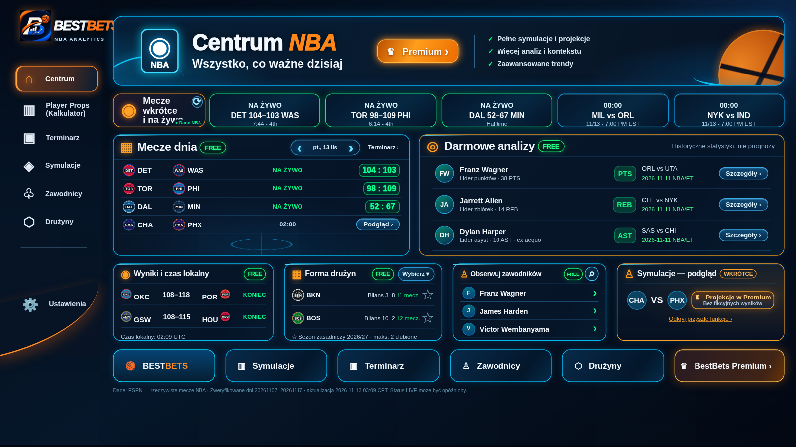
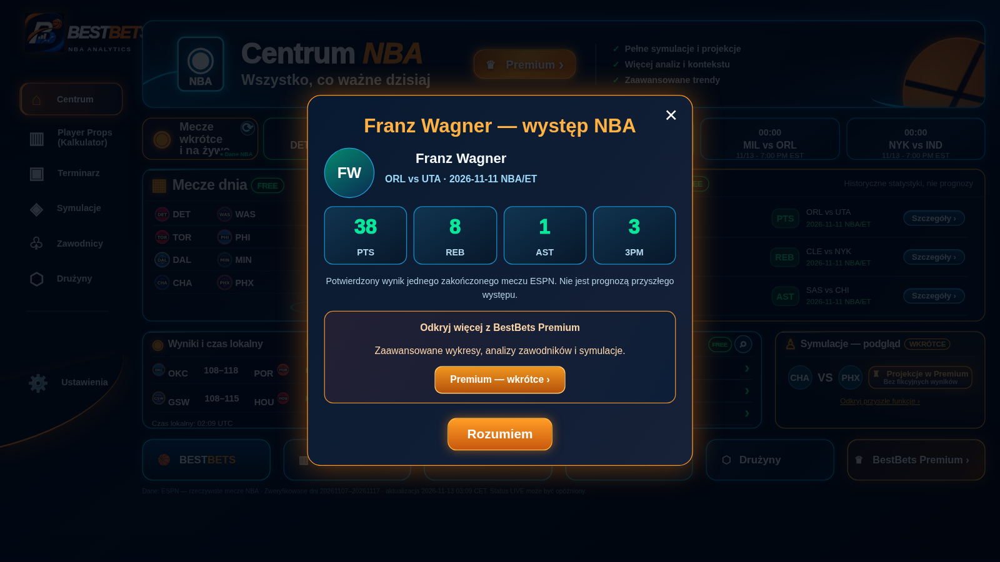

# Centrum: darmowi liderzy i szczegóły jednego meczu (PR #66)

Zmiana rozwija istniejący PR #66. Publiczny `app.py`, algorytmy i wygląd
Player Props, skalowanie, iframe, wymiary paneli, menu i sześć dolnych
przycisków pozostają bez zmian. Nie dodaje płatności, logowania ani paywalla.

## Dane i aktualizacja

`bestbets_free_analyses.py` wybiera po jednym liderze PTS, REB i AST z
**najnowszego dnia NBA w strefie America/New_York (NBA/ET)** zawierającego
zakończone mecze ESPN. Wyświetlana data NBA/ET jest opisana jawnie; mecze
po północy w Polsce nie są rozdzielane na różne amerykańskie kolejki.
W trwającym dniu pod uwagę brane są tylko już zakończone spotkania.

Najpierw wybierana jest data zakończonych meczów, dopiero potem sprawdzane są
statystyki. Brakujące dane nie powodują powrotu do starszych liderów. Do
potwierdzenia maksimum kategorii wymagani są liderzy obu drużyn każdego
zakończonego meczu tego dnia. Niepełna kategoria ma własny komunikat; błąd
pobrania nowszej daty blokuje stwierdzenie, który dzień jest najnowszy.
Jeden zawodnik może wygrać kilka kategorii. Remis jest oznaczony „ex aequo”;
stabilny wybór jednego wiersza opiera się na dacie i identyfikatorach ESPN.

Istniejące dzienne scoreboardy i odświeżanie Centrum co 120 s są używane
ponownie. Dotychczasowy feed `players` dla obserwowanych zawodników pozostaje
niezmieniony; nowe `free_leaders` są od niego niezależne.

Przycisk „Szczegóły” wysyła klucz wiersza. Serwer wyszukuje go wyłącznie we
własnym snapshotcie; przekazane przez klienta identyfikatory, nazwiska i URL-e
nie decydują o zapytaniu. Dla jednego meczu sprawdzane są ID meczu, stan final,
data NBA/ET, drużyny, gospodarz/gość, ID i nazwisko zawodnika oraz zgodność
wyniku lidera z boxscore. Wyświetlane są tylko pełne PTS/REB/AST/3PM, bez
zastępowania braków zerami. Surowy boxscore i pomyślne szczegóły mają cache
120 s. Błąd pokazuje komunikat; dane ze starego cache są oznaczane.

To oddzielna ścieżka od `_research` Player Props: nie pobiera historii sezonu,
nie liczy modeli ani symulacji. Odpowiedź do wcześniej klikniętego wiersza
nie nadpisuje późniejszego wyboru i nie otwiera ponownie zamkniętego okna.

## Zdjęcia: domyślnie wyłączone

Właściciel potwierdził brak udokumentowanej licencji i wybrał **inicjały na
produkcji**. Nowa sekcja oraz jej modal nie wysyłają żądań zdjęć, dopóki
operator świadomie nie ustawi:

```sh
BESTBETS_CENTRE_HEADSHOTS_LICENSED=true
```

Nie ustawiać tej zmiennej w Streamlit produkcyjnym przed uzyskaniem praw.
Nie jest sekretem ani samodzielnym potwierdzeniem licencji. Jej brak lub
wartość inna niż `true` pozostawia inicjały. Flaga dotyczy wyłącznie nowych
zdjęć Centrum; nie zmienia istniejącego Player Props.

Opcja korzysta tylko z numerycznego **ESPN athlete ID** pochodzącego z
potwierdzonego scoreboardu i stałego endpointu:
`https://a.espncdn.com/i/headshots/nba/players/full/{ESPN_ID}.png`.
Identyfikatory ESPN nie są podstawiane do CDN NBA. URL przekazany przez
klienta lub upstream jest ignorowany. `object-fit: contain` zachowuje
proporcje, ramkę i przezroczystość źródła; błąd obrazu pozostawia inicjały.
Niezmienione wiersze nie są przebudowywane przy ponownym renderze, a obrazy
korzystają ze standardowego cache przeglądarki.

Publiczny endpoint nie stanowi licencji. Sprawdzone źródła warunków:
[NBA Terms of Use](https://www.nba.com/termsofuse) oraz
[Disney Terms of Use (ESPN)](https://disneytermsofuse.com/).
Nie potwierdzają zgody dla tego zastosowania BestBets; przed włączeniem
potrzebna jest weryfikacja i udokumentowanie odpowiednich uprawnień.
Ten opis nie jest opinią prawną ani zgodą właściciela praw.

## Zakres Free / przyszłe Premium

Free: trzej liderzy, dane zawodnika i cztery statystyki jednego meczu.
W modalu jedynie zapowiedź „Odkryj więcej z BestBets Premium”: wykresy,
analizy i symulacje. Planowana cena przyszłego produktu: **9,99 USD/mies.**
Nie uruchomiono płatności ani ograniczeń obecnego Player Props.

## Testowanie lokalne

```sh
python -m unittest discover -v
python -m playwright install chromium
python test_free_analyses_browser.py
streamlit run app.py --server.port 8522
# W drugim terminalu:
python test_centre_browser.py --url http://127.0.0.1:8522
python test_centrum_premium_ui.py --url http://127.0.0.1:8522 \
  --baseline-ref 4c7d2a295b1bcbdc3f0d9937566aa6eddbb92bb3 \
  --out work/centrum-qa/pr66
```

Nowe testy jednostkowe obejmują kategorię, dobę NBA/ET, remis, brak danych,
ID, podpis wiersza, błędny boxscore i manipulację zdarzeniem komponentu.
Test Playwright sprawdza trzy desktopowe rozdzielczości, komplet dolnych
przycisków, modal, spóźnione odpowiedzi, brak zapytań zdjęć przy wyłączonej
fladze, poprawne załadowanie obrazu i fallback 404 po jej testowym włączeniu.
Syntetyczne fixture'y są wyłącznie w plikach testów. Produkcja otrzymuje
wyłącznie rzeczywiste odpowiedzi NBA/ESPN.

## Wyniki przed scaleniem

- 239/239 testów unittest.
- Centrum: pięć rozmiarów, w tym mobile; sześć dolnych kafelków w komplecie.
- Player Props: 10/10 porównań obrazu bez istotnych różnic (ten sam próg rastrowania co PR #65).
- Streamlit: 4/4 testy stabilnej pierwszej geometrii i braku stopniowego przybliżania.
- Playwright: modal, błędne/nieaktualne odpowiedzi, braki danych, zdjęcia opt-in i fallback na trzech desktopowych rozmiarach.
- ESPN: trzy rzeczywiste boxscore zgodne z wierszami liderów; opcjonalne endpointy zdjęć zwróciły PNG RGBA 600×436 dla właściwych ID. Zdjęcia pozostają wyłączone.





[Raport geometrii, startu i porównań Player Props](centrum-pr66/results.json).

Powyższe obrazy pochodzą z lokalnego Streamlit z rzeczywistym feedem ESPN.
Stan liderów zmienia się po zakończeniu kolejnych meczów; obrazy nie są źródłem danych aplikacji.
