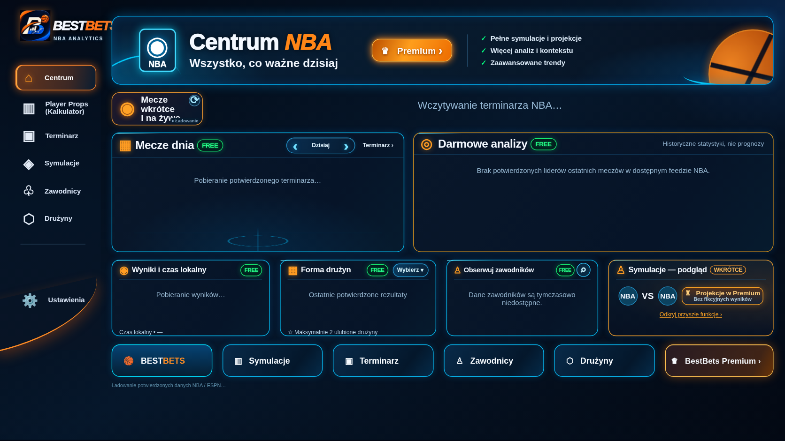

# Centrum — aktualizacja PR #65

Zmiana rozwija istniejący PR #65 na gałęzi
`fix/centrum-visible-bottom-navigation-20261113`. Nie utworzono konkurencyjnego
PR ani nie połączono go z wcześniejszym lokalnym szkicem.

## Efekt

- Główne panele: **222 → 188 px**, redukcja **15,3%**.
- Cztery mniejsze karty: **135 → 120 px**.
- Wiersze meczów: 28 px; analiz: 48 px. Zachowano czytelne etykiety i przyciski.
- Dolna nawigacja jest wyżej i w całości widoczna bez przewijania strony na
  1920×1080, 1600×900 i 1366×768, z co najmniej 12 px zapasu w testach.
- Zachowano kolory, poświaty, fonty, szerokość, sidebar, globalne skalowanie
  i iframe. Kod Player Props, HTML, JavaScript i backend NBA pozostają bez zmian.

Wykorzystano układ już przygotowany w PR #65. Dodatkowo wysokość lokalnego
kontenera dopasowano do sumy jego wierszy i przerw: **585 px**. Lista meczów
ma limit 140 px, aby pięć pełnych wierszy mieściło się wewnątrz panelu. Dłuższy
terminarz nadal korzysta z istniejącego przewijania samej listy.

## Naprawiony test CI

Pierwotny test PR #65 porównywał wysokość ekranową panelu ze stałym limitem
260 px. Na ekranie 1920 px poprawnie skalowany panel 188 px ma około 293 px,
więc test zgłaszał fałszywą regresję. Potwierdzono to w logu nieudanego workflowu.

Test przelicza teraz geometrię na istniejące współrzędne sceny 1231 px i
kontroluje redukcję głównych paneli o 15–20%. Nie zmienia skali aplikacji.
Dodatkowe kontrole wykrywają przycięte ostatnie wiersze i potwierdzają dostęp
do ósmego meczu przez przewinięcie listy, bez przesuwania całej strony.

## Wyniki lokalne

| Kontrola | Wynik |
|---|---|
| Centrum: 1920×1080, 1600×900, 1366×768, 390×844 i 1672×941 | PASS |
| Player Props: pusty ekran i wykres testowy na pięciu rozmiarach | **10/10 identycznych obrazów** |
| Rzeczywisty Streamlit: pierwsza widoczna geometria i ponad 3 s obserwacji | **4/4**, stabilny start |
| Pełne nazwy i widoczność sześciu dolnych przycisków | PASS |
| Trzy analizy, dwa wyniki oraz pięć/osiem meczów w panelach | PASS |
| Istniejący browser test Centrum: daty, ulubione drużyny, wyszukiwarka zawodników i routing | PASS |
| Regresje projektu, unittest | **222/222** |

Na mobile pozostaje dotychczasowe proporcjonalne skalowanie. Zrzuty Centrum
pokazują aktualny stan ładowania/niedostępności danych; nie podstawiano
fikcyjnych wyników NBA. Syntetyczne dane są wyłącznie w testach i oznaczone.

[Wyniki pomiarów JSON](centrum-pr65/results.json).

## Gotowość do wdrożenia

Nie wprowadzono nowych zależności, sekretów, migracji ani zmian konfiguracji.
Po zielonych kontrolach CI aktualizacja jest przygotowana do akceptacji i
scalenia istniejącego PR #65. Publicznej gałęzi `main` i strony Streamlit nie
zmieniono w ramach tej pracy.

Po zaakceptowanym scaleniu należy sprawdzić publiczne Centrum na trzech
rozmiarach desktopowych oraz przejście do Player Props. Samo wdrożenie pozostaje
po stronie właściciela, zgodnie z wymogiem wcześniejszej akceptacji.

Lokalny podgląd: `python -m streamlit run app.py --server.port 8521`, następnie
http://127.0.0.1:8521/.
