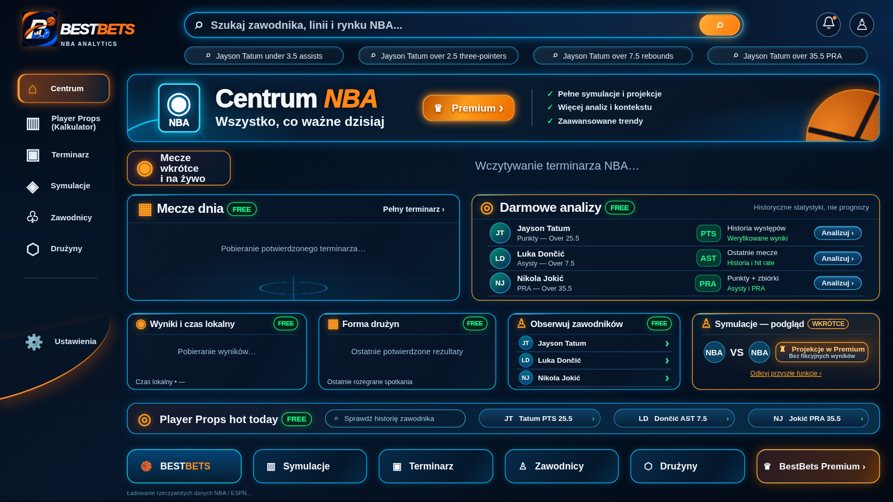

# Centrum — Premium UI 2.0

Zmiana powstała na osobnej gałęzi `feature/centrum-premium-ui-20261112` od
aktualnego `main`, commit `89d7d09ebedd9f968440c1c4071c73bd2f4fd153`.
Nie wdrożono jej na publiczną stronę i nie scalono do `main`.

Wzorem jest dostarczona przez właściciela grafika 1672×941. Cały kod wizualny
zmieniono w **`bestbets_reference_frontend/centrum.css`**. HTML, JavaScript,
backend i globalny mechanizm skalowania pozostały identyczne z bazą.

## Zmiany wizualne

| Obszar | Zmiana |
|---|---|
| Układ Centrum | Odtworzone położenie, szerokości i wysokości sześciu głównych sekcji z grafiki |
| Odstępy | Zamiast jednolitej przerwy 6 px: przerwy 12–20,5 jednostek istniejącego układu, zależnie od sekcji |
| Hero | Większy padding, odseparowane logo NBA, nagłówek i korzyści Premium; dopasowane akcenty oraz dekoracyjna piłka |
| Dwa główne panele | Szersza przerwa między kolumnami, odpowiednie proporcje, poprawiony padding i nagłówki |
| Mecze dnia | Subtelna dekoracja boiska w tle; pięć rzeczywistych wierszy nadal mieści się w panelu |
| Cztery mniejsze karty | Równomierne odstępy, uporządkowane nagłówki i treść, zachowane notatki o danych |
| Player Props hot today | Proporcje tytułu, pola informacyjnego i trzech skrótów zgodne z referencją |
| Sześć dolnych kafelków | Niższe, jednoliniowe etykiety; kompletne nazwy i pomarańczowy akcent Premium. Dotychczasowe opisy pozostają dostępne dla czytników ekranu |
| Nagłówek i sidebar Centrum | Dopasowane odstępy, położenie wyszukiwarki, chipów i logo; zmiany działają tylko przy aktywnej trasie Centrum |

Zachowano granatowe tło, niebieskie neonowe obramowania, pomarańczowe akcenty,
zaokrąglenia i poświaty. Logo jest oryginalnym zasobem projektu. Dyskretna
informacja o źródle danych pozostaje pod kafelkami, choć nie ma jej na referencji.

## Granice zmiany

- Player Props, jego wykresy, animacje, kontrolki i karty nie otrzymały zmian.
- `app.py`, `bestbets_custom_screen.py`, `index.html`, `centrum.html` i
  `centrum.js` są identyczne z bazą.
- Nie zmieniono skali `viewportWidth / 1231`, transformacji `#stage`, wysokości
  iframe, komunikatów Streamlit ani rozwiązania wypełniającego szerokość.
- Nie dodano dodatkowego `zoom` lub `transform: scale()` do Centrum.
- Nie zmieniono źródeł statystyk NBA, logiki wyszukiwania, nawigacji ani danych.
- Nie dodano kont, płatności, paywalla, nowych symulacji lub prognoz.
- Przycisk Premium nadal otwiera dotychczasową informację o przyszłych funkcjach.

## Wyniki Playwright

| Rozdzielczość | Centrum: widoczne sekcje, bez nakładania | Player Props przed/po, pusty i z wykresem testowym | Rzeczywisty Streamlit: stabilny start |
|---|---|---|---|
| 1920×1080 | PASS | **0 zmienionych pikseli** | PASS |
| 1600×900 | PASS | **0 zmienionych pikseli** | PASS |
| 1366×768 | PASS | **0 zmienionych pikseli** | PASS |
| 390×844 | PASS | **0 zmienionych pikseli** | PASS |
| 1672×941 — rozmiar referencji | PASS | **0 zmienionych pikseli** | porównanie statyczne |

Łącznie: **5 rozmiarów Centrum, 10 porównań pikselowych Player Props oraz
4 próby startu rzeczywistego Streamlit**. To grupy kontroli, a nie suma przypadków pytest.

W każdym rzeczywistym iframe sonda obserwowała pierwszą widoczną geometrię i
ponad 3 sekundy dalszego działania. Od pierwszej próbki szerokość sceny jest
równa szerokości viewportu. Dopuszczalny dryf wymiarów wynosi 1,5 px; wszystkie
cztery rozdzielczości przeszły. Brak błędów JavaScript; sześć dolnych kafelków
jest dostępnych w granicach iframe. Testy nie wymagają zakończenia pobierania NBA
do pokazania pierwszego ekranu.

Sprawdzono także: pełne nazwy kafelków, brak poziomego overflow, pięć wierszy
meczów, szczegóły meczu, pełny terminarz, okno Premium, zamykanie okien,
dolną nawigację i wyszukiwanie z kart zawodników.

**Mobile zachowuje dotychczasowy proporcjonalny mechanizm aplikacji.** Przy
390 px szerokości scena ma około 219 px wysokości, a pozostała część wysokiego
ekranu pokazuje istniejące tło. Nie wprowadzono nowego pionowego układu mobilnego,
ponieważ wymagałoby to wyjścia poza zatwierdzony zakres skalowania/shella.

## Porównanie z referencją

Zmierzono sześć prostokątów głównych sekcji w dostarczonym obrazie. Test sprawdza
położenie i wielkość każdego z nich w rozmiarze 1672×941 z tolerancją 3 px.
Maksymalna uzyskana różnica wynosi **0,86 px**. Osobno wykonano oględziny
zrzutu względem grafiki: odstępy, kolory, nagłówek, proporcje paneli i dolne karty.

Ta liczba opisuje **prostokąty sekcji**, nie identyczność wszystkich pikseli
grafiki referencyjnej. Referencja została przekazana jako obraz w rozmowie;
nie ma jej pliku źródłowego w repozytorium, dlatego nie raportujemy fikcyjnego
pełnoekranowego pixel diffu. Dokładny pixel diff wykonano dla Player Props,
porównując render starego i nowego kodu w tej samej przeglądarce.



## Zrzuty i dane wynikowe

- [Centrum przed zmianą](centrum-premium-ui/centrum-before-1672x941.png)
- [Centrum po zmianie — 1672×941](centrum-premium-ui/centrum-after-1672x941.png)
- [1920×1080](centrum-premium-ui/centrum-after-1920x1080.png)
- [1600×900](centrum-premium-ui/centrum-after-1600x900.png)
- [1366×768](centrum-premium-ui/centrum-after-1366x768.png)
- [390×844](centrum-premium-ui/centrum-after-390x844.png)
- [Rzeczywisty Streamlit 1920×1080 z danymi pobranymi przez istniejący backend](centrum-premium-ui/centrum-streamlit-1920x1080.png)
- [Maszynowy zapis pomiarów](centrum-premium-ui/results.json)

Zrzuty porównawcze Centrum pokazują stan ładowania zgodny z referencją, bez
wymyślonych wyników. Syntetyczne mecze i „Test Athlete” służą wyłącznie testom;
nie są umieszczane w kodzie aplikacji ani prezentowane jako fakty NBA.

## Pozostałe kontrole

- **201/201** testów projektu: `python -m unittest discover -q`.
- Istniejące testy geometrii, wykresów i nawigacji: `test_browser_reference_v10.py` — PASS.
- Dotychczasowy test Centrum w przeglądarce: `test_centre_browser.py` — PASS.
- Zgodność chronionych źródeł i zasobów z `main`, whitespace i składnia — PASS.

Jedna dawna asercja `test_reference_shell_v90.py` wskazywała już nieużywany
punkt wejścia `bestbets_v90`. Zaktualizowano wyłącznie test, aby sprawdzał
rzeczywisty `bestbets_custom_screen`. Publiczny `app.py` nie został zmieniony.

## Lokalny podgląd

Na tej gałęzi, w środowisku z zależnościami projektu:

```bash
python -m streamlit run app.py --server.port 8520 --server.address 127.0.0.1
```

Otwórz **http://127.0.0.1:8520/**. To lokalny podgląd, niezależny od publicznego
wdrożenia Streamlit Cloud. Nie wymaga konfiguracji Auth0 ani Stripe.

Odtworzenie testów (lokalny podgląd pozostaje uruchomiony):

```bash
python -m pip install playwright Pillow
python -m playwright install chromium
python test_centrum_premium_ui.py --url http://127.0.0.1:8520 --out work/centrum-premium
```

Bez `--url` działa zestaw statyczny: geometria, interakcje i porównania Player Props.
`--baseline-ref` pozwala wskazać commit bazowy zamiast domyślnego `origin/main`.
Workflow **BestBets Centrum Premium UI** powtarza kontrole na osobnym runnerze
GitHub i zapisuje wszystkie zrzuty oraz JSON jako artefakt `centrum-premium-ui-evidence`.

## Zmienione pliki

1. `bestbets_reference_frontend/centrum.css` — cała zmiana wizualna.
2. `test_centrum_premium_ui.py` — testy geometrii, interakcji, pixel diff i uruchamiania iframe.
3. `test_reference_shell_v90.py` — poprawiona jedna przestarzała asercja.
4. `.github/workflows/centrum-premium-ui.yml` — automatyzacja przeglądarkowa i artefakty.
5. `docs/CENTRUM_PREMIUM_UI_2_0.md` — niniejszy raport i instrukcja.
6. `docs/centrum-premium-ui/results.json` — wyniki pomiarów.
7. `docs/centrum-premium-ui/*.png` — siedem wymienionych zrzutów.
