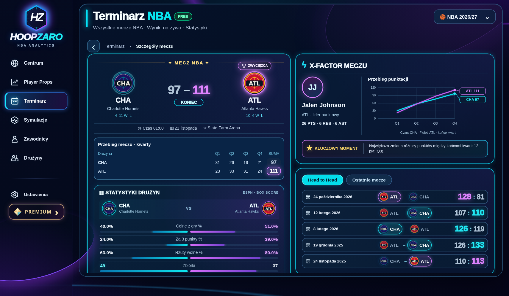
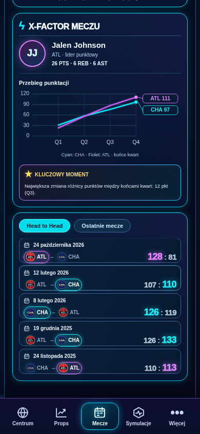

# HOOPZARO Game Center — referencja Premium

Zmiana rozwija wyłącznie ekran szczegółów meczu z aktualnego `main`
(`c073774`). Pozostałe zakładki, `app.py`, źródła ESPN, konta i uprawnienia
Premium pozostają bez zmian. Wykres nadal przedstawia potwierdzone sumy na
koniec kwart, a nie wymyślony przebieg play-by-play.

## Wygląd i reguły wyniku

- Head to Head i Ostatnie mecze: pełna polska data z ikoną kalendarza,
  dwa herby i skróty oraz duży wynik po prawej.
- Zwycięski klub i jego punkty otrzymują spójne podświetlenie. Cyan jest
  przypisany do klubu z lewej strony głównego meczu, fiolet do prawego.
  Odwrócenie gospodarza/gościa w historii nie zmienia koloru klubu.
  Inni zwycięzcy w ostatnich meczach mają złoty akcent.
- Zwycięzca wymaga zakończonego meczu, dwóch nieujemnych całkowitych wyników
  i braku remisu. Samo prowadzenie w meczu live nie daje odznaki zwycięzcy.
- Główna karta: subtelna poświata herbu, wyróżniony wynik, puchar i napis
  ZWYCIĘZCA oraz podświetlona suma kwart. Wybór wynika z porównania wyników,
  nigdy z gospodarza/gościa.
- X-Factor: kontrastowe linie, siatka z wartościami osi, oznaczenia Q1–Q4/OT,
  punkty końcowe i etykiety z rzeczywistymi sumami. Zbliżone etykiety są
  odsuwane; zmierzone punkty wykresu nie są przesuwane.
- Lider i złoty KLUCZOWY MOMENT są czytelniej wyeksponowani. Zachowano
  obliczanie największej zmiany różnicy między końcami kwart.

Jeżeli dla meczu zakończonego brakuje pełnych kwart lub ich suma nie zgadza
się z wynikiem ESPN, używany jest dotychczasowy widok zastępczy z wynikiem.
Nie dopisuje się brakujących kwart ani statystyk. Nie zmieniono pobierania,
cache ani parsowania źródeł ESPN.

## Responsywność i zakres

Na telefonie pełna data zajmuje osobny wiersz nad herbami i wynikiem.
X-Factor wykorzystuje pełną szerokość pod nagłówkiem lidera. Nazwy klubów
w głównej karcie mogą się zawijać, zamiast znikać lub być obcinane.
Przewijanie pionowe i mobilna nawigacja pozostają dostępne.

Team Comparison zachowuje swój kod, układ, dane i wszystkie dziesięć
metryk. Referencja pokazuje część tej tabeli; dalsze metryki pozostają
dostępne przez dotychczasowe przewijanie szczegółów. Nie usunięto żadnej
funkcji, aby dopasować zawartość do pojedynczego zrzutu.

## Walidacja przed scaleniem

| Kontrola | Wynik lokalny |
|---|---|
| Wszystkie testy `unittest discover` | 371/371 PASS |
| Nowy test Playwright Game Center | 10 rozdzielczości PASS |
| Zwycięstwo gospodarza i gościa, kolory historyczne, dogrywka | PASS |
| Niepełne/sprzeczne kwarty, live i brak wyniku | Bezpieczny fallback PASS |
| Pozostałe widoki: porównanie obrazu przed/po | 9/9 bez zmienionych pikseli powyżej 4 RGB |
| Rzeczywisty Streamlit: iframe, skala, przewijanie | 4 rozdzielczości PASS |
| Istniejące testy Centrum, wyszukiwania, Terminarza i symulacji | PASS |
| Testy Node: Game Center, Terminarz i symulacje | PASS |

Testy obejmują 1920×1080, 1710×998, 1600×900, 1366×768, 768×1024,
430×932, 390×844, 360×800, 320×720 i 844×390.

Uaktualniono również stare fixture'y testowe: pełne kwarty w teście
Game Center, mock DOM obecnego Terminarza V4 i stałą datę/model testowej
symulacji. Kod aplikacji poza Game Center pozostał niezmieniony.

Zrzuty poniżej wykorzystują rzeczywiste dane ESPN: CHA 97–111 ATL
(ID 401909305, 21.11.2026 01:00 Europe/Warsaw), kwarty 31/26/19/21
i 23/33/31/24 oraz pięć spotkań H2H. Osobno sprawdzono zwycięstwo gości:
ORL 113–111 BKN (401909306). Syntetyczne przypadki brzegowe istnieją
wyłącznie w testach.





## Polecenia QA

```sh
python -m unittest discover -v
node test_game_center_premium.js
node test_schedule_board.js
node test_simulations_canvas.js
python test_game_center_premium_browser.py
python test_browser_reference_v10.py
python test_schedule_mobile.py
python test_hoopzaro_ui.py
python test_simulations_browser.py
```

W zarządzanym środowisku Cloud systemowy Chromium blokuje adresy `file://`.
Istniejące testy katalogów drużyn/zawodników i symulacji wykonano również
przez lokalny serwer HTTP z tymi samymi plikami i fixture'ami. Nie wyłączano
weryfikacji TLS ani zabezpieczeń przeglądarki.

Nowy workflow `game-center-premium.yml` ponownie uruchamia pełne testy
jednostkowe i testy nowego widoku dla każdego PR do `main`. Publikacja
wymaga zielonych kontroli i zgodności z przetestowanym SHA.
